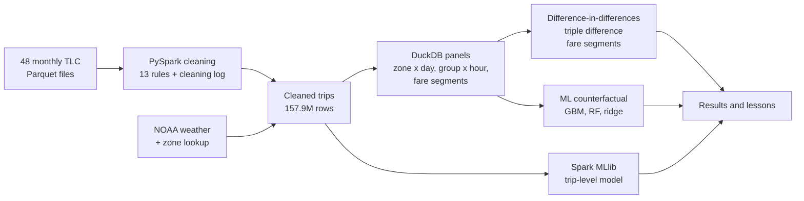

<div align="center">

# Pricing the Streets
### Congestion pricing, taxi fares and traffic speed in New York City · 2022–2025

A big-data study of 157.9 million NYC yellow-taxi trips, measuring what the January 2025 congestion toll and the December 2022 taxi fare rise did to traffic speeds and taxi demand, with lessons for Indian cities.


[Overview](#overview) · [Key findings](#key-findings) · [Methods](#methods) · [Data](#data) · [Repository structure](#repository-structure) · [How to run](#how-to-run) · [Limitations](#limitations) · [Author](#author)

</div>

---

## Overview

On **5 January 2025** New York became the first US city to charge cars for entering its busiest district: Manhattan at and below 60th Street. The toll is **$9 at peak** and **$2.25 overnight**. Two years earlier, on **19 December 2022**, the city had raised yellow-taxi fares by roughly a third.

New York has no citywide network of road sensors, but every yellow taxi records each trip it makes. Dividing distance by duration gives a speed, so **157.9 million trips work as a fleet of moving speed sensors**.

The project asks:

1. How did trip volumes, speeds and fares change over 2022–2025?
2. Did the toll make streets faster, and did taxi pickups fall?
3. Are the gains largest at peak hours, when the toll is highest? (a test of cause)
4. Did the 2022 fare rise reduce taxi demand?
5. Do machine-learning and Spark models agree with the statistical estimates?
6. What transfers to Indian cities, and under which conditions?

## Key findings

| Question | Result |
|---|---|
| Speed in the charging zone | About **+1 to 3%** faster than north Manhattan (a lower bound), mostly in early 2025, fading in the second half of the year |
| Peak vs overnight (the mechanism) | Speed gain about **3.9 to 4.5 percentage points larger at peak**, the toll's own pattern (p = 0.005). The same test on a fake January 2024 toll found nothing |
| Taxi pickups | **−2 to −5%** inside the zone, **−6 to −8%** in the buffer strip just outside it |
| 2022 fare rise | No measurable fall in demand: revenue **+29%**, trips **−3%**. Elasticity estimate is inconclusive (sign changes across methods) |
| Machine learning check | Gradient boosting, random forest and ridge give speed about **+0.9 to 1.0%** and pickups about **−4.7 to −5.2%**. Spark GBT on trip level gives **+2.4%** |
| Consistency with research | Same direction as Cook et al. (2025, NBER); smaller size. London's gains also faded |

> These are the figures in the project deck. The notebook was re-run after December 2023 was restored in the data, so re-check the pre-toll trend, the 2024 placebo and the 2023–24 baseline against the latest output.

**Lessons for Indian cities:** price the peak (FASTag and plate cameras make this enforceable), pair charges with better buses and metro because gains can fade, cover two-wheelers and autos and not only cars, and require aggregators to share anonymised trip data so policies can be evaluated.

## Methods



**Study design.** Taxi zones are split by the 60th Street line into a **charging zone** (38 zones), a **buffer** (6 zones straddling the line) and a **control** in north Manhattan (20 zones, no toll). About 31.5% of control trips also paid the fee, so estimates are lower bounds.

| Method | Question it answers |
|---|---|
| Difference-in-differences | How much did the zone change compared with north Manhattan? |
| Triple difference (peak vs overnight) | Is the gain biggest when the toll is $9, as a causal effect should be? |
| Fare-segment design | Did trip types with bigger fare rises lose more riders, net of a placebo year? |
| ML counterfactual | Train on 2022–24, predict a no-toll 2025, subtract the same exercise on a fake 2024 toll |
| Event study, placebo and pre-trend tests | Does the effect start at the toll date, and fade? |
| OLS with Newey–West errors | How do weather and holidays move trips and speed? (controlled in every model) |
| Spark MLlib | Does the result hold at trip level, and how does it scale? |

## Data

| Source | Use |
|---|---|
| [NYC TLC yellow-taxi trip records](https://www.nyc.gov/site/tlc/about/tlc-trip-record-data.page), Jan 2022 – Dec 2025 (48 monthly Parquet files) | Trips |
| [TLC taxi zone lookup](https://d37ci6vzurychx.cloudfront.net/misc/taxi_zone_lookup.csv) and zone shapefile | 263 zones and boroughs |
| [NOAA GHCN-Daily](https://www.ncei.noaa.gov/data/global-historical-climatology-network-daily/access/USW00094728.csv), Central Park station USW00094728 | Daily weather |

**Cleaning result:** 167,858,646 trips in, **157,891,025 kept**, 9,967,621 removed (5.9%). Thirteen rules are applied in order, and each trip is removed by the first rule it fails. The biggest causes are negative fares (3.8M), zero-distance trips (3.5M) and invalid passenger counts (1.9M). Zero fares are kept and flagged `is_zero_fare`. See `data/CLEANING_RULES.csv` and `data/cleaning_log_summary_all_years.csv`.

**Not stored here.** The trip-level data is far above GitHub's 100 MB file limit. To rebuild it, download the monthly files from the TLC link above and run the cleaning script (see below). The hourly zone panel (`agg_hourly_zone.parquet`, about 170 MB) is also not included for the same reason.

## Repository structure

```
pricing-the-streets-nyc/
├── README.md
├── requirements.txt
├── .gitignore
├── src/
│   └── nyc_taxi_clean.py                 # PySpark cleaning + enrichment + aggregates
├── notebooks/
│   ├── Big_Data_Cleaning.ipynb           # data build: cleaning runs, weather, data dictionary
│   └── nyc_taxi_full_analysis.ipynb      # descriptive stats, regression, causal, ML and Spark
├── data/
│   ├── agg_daily_borough.csv             # daily trips, fares, tolls and weather by borough
│   ├── weather_daily.csv                 # cleaned daily weather (metric)
│   ├── noaa_nyc_daily.csv                # raw NOAA download, 2022-2025
│   ├── DATA_DICTIONARY.csv               # every column explained
│   ├── CLEANING_RULES.csv                # 13 rules and rows removed
│   └── cleaning_log_summary_all_years.csv
└── reports/
    └── Pricing_the_Streets.pptx          # presentation
```

| File | Purpose |
|---|---|
| `src/nyc_taxi_clean.py` | Harmonises the schema across years, applies the 13 cleaning rules, writes a cleaning log, adds zone names, trip duration, speed, toll flags and weather, and writes the cleaned data and small aggregates |
| `Big_Data_Cleaning.ipynb` | Runs the cleaning month by month, downloads the zone lookup and weather, and builds the data dictionary and handoff files |
| `nyc_taxi_full_analysis.ipynb` | The full analysis: data foundation, descriptive statistics, regressions and diagnostics, congestion effect, peak-hour mechanism, fare sensitivity, machine learning, results table and Spark |
| `DATA_DICTIONARY.csv` | Column-level documentation for the cleaned data and aggregates |

## How to run

The notebooks were built in **Google Colab** with files on Google Drive.

1. Download the monthly `yellow_tripdata_YYYY-MM.parquet` files (2022–2025) and the zone lookup from the links above into one folder.
2. Clean the data, one year at a time:
   ```bash
   pip install -r requirements.txt
   python src/nyc_taxi_clean.py \
       --input  "path/to/parquet_files" \
       --zones  "path/to/taxi_zone_lookup.csv" \
       --weather "data/noaa_nyc_daily.csv" \
       --out    "path/to/out_2023" \
       --only 2023-01,2023-02,2023-03   # list the months for the year
   ```
   Useful options: `--start-date`, `--end-date`, `--max-fare`, `--max-mph`, `--dedupe`, `--driver-memory 8g`.
3. Open `notebooks/nyc_taxi_full_analysis.ipynb` and point its folder variables at your cleaned data. Run the sections in order. Section 6 (Spark) is optional.

Running the full analysis needs a machine with enough memory for Spark. A free Colab session may require running the cleaning year by year, as the notebook does.

## Limitations

- **Pre-trends are not parallel.** The charging zone was already slowing relative to north Manhattan before the toll, so the speed effect is a range, not one number.
- **Partly treated control.** About 31.5% of control trips paid the fee, so estimates are lower bounds.
- **2025 data changes.** The cleaning removal rate roughly doubled (4.5% to 9.9%), and passenger count is often blank, mainly affecting volume measures.
- **Zones, not streets.** The toll-free FDR Drive and West Side Highway cannot be separated.
- **Yellow taxis only.** Uber and Lyft, the larger market, are not observed.
- **One year after the toll,** and the fare results are relative (across trip types), not total.
- **Cleaning removes trips,** including zero-distance and invalid passenger counts, so volumes run slightly low. Tips are card-only (cash tips are not recorded). One weather station (Central Park) is applied citywide.

## Author

**Nandini Sharma**

## License

Code is released under the [MIT License](LICENSE). Trip records are public data from the NYC Taxi & Limousine Commission and weather data are from NOAA. This work is for educational purposes.
